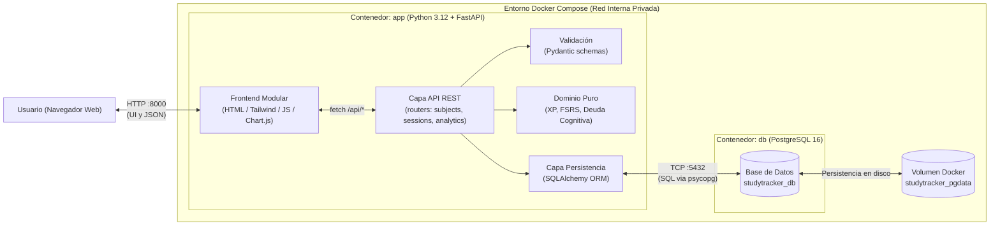
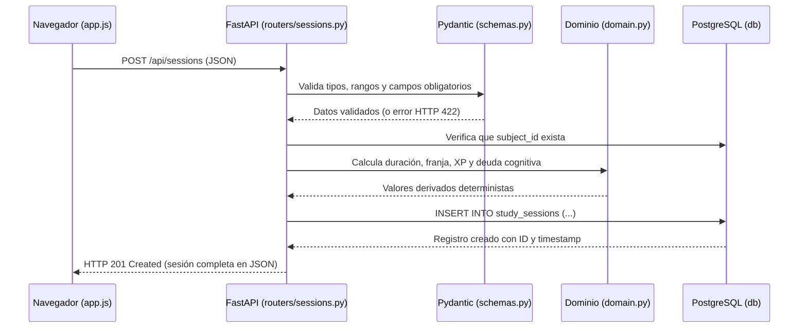
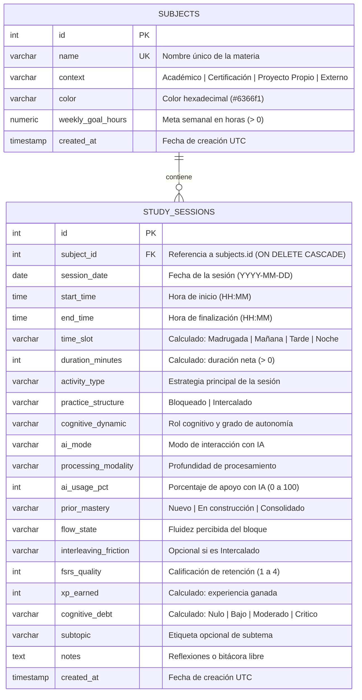

# Guía de Arquitectura y Desarrollo Paso a Paso: StudyTracker

> **Propósito de este documento:** Manual técnico autocontenido que define la arquitectura, el stack tecnológico, los contratos de datos y el plan de implementación por fases para construir **StudyTracker** desde cero. Está redactado con rigor de arquitectura de software pero explicado desde los fundamentos, de modo que cualquier desarrollador con conocimientos básicos pueda seguirlo paso a paso sin generar deuda técnica.

---

## Tabla de Contenidos

1. [Visión General y Problema que Resuelve](#1-visión-general-y-problema-que-resuelve)
2. [Principios de Arquitectura y Anti-Patrones a Evitar](#2-principios-de-arquitectura-y-anti-patrones-a-evitar)
3. [Stack Tecnológico y Justificación](#3-stack-tecnológico-y-justificación)
4. [Arquitectura del Sistema y Estructura del Repositorio](#4-arquitectura-del-sistema-y-estructura-del-repositorio)
5. [Especificación del Modelo de Datos (PostgreSQL)](#5-especificación-del-modelo-de-datos-postgresql)
6. [Especificación del Dominio y Reglas de Negocio](#6-especificación-del-dominio-y-reglas-de-negocio)
7. [Contrato de la API REST](#7-contrato-de-la-api-rest)
8. [Convenciones de Versionado (Git y Conventional Commits en Español)](#8-convenciones-de-versionado-git-y-conventional-commits-en-español)
9. [Plan de Implementación por Fases](#9-plan-de-implementación-por-fases)
   - [Fase 0: Preparación del Entorno y Repositorio](#fase-0-preparación-del-entorno-y-repositorio)
   - [Fase 1: Infraestructura Contenerizada con Docker y PostgreSQL](#fase-1-infraestructura-contenerizada-con-docker-y-postgresql)
   - [Fase 2: Capa de Dominio Pura y Pruebas Unitarias](#fase-2-capa-de-dominio-pura-y-pruebas-unitarias)
   - [Fase 3: Persistencia Relacional con SQLAlchemy y PostgreSQL](#fase-3-persistencia-relacional-con-sqlalchemy-y-postgresql)
   - [Fase 4: Validación de Contratos y API REST con FastAPI](#fase-4-validación-de-contratos-y-api-rest-con-fastapi)
   - [Fase 5: Motor Analítico y Agregaciones](#fase-5-motor-analítico-y-agregaciones)
   - [Fase 6: Interfaz Web Modular y Dashboard Interactivo](#fase-6-interfaz-web-modular-y-dashboard-interactivo)
   - [Fase 7: Carga de Datos Iniciales (Seed), Exportación y Persistencia](#fase-7-carga-de-datos-iniciales-seed-exportación-y-persistencia)
   - [Fase 8: Verificación Integral, Documentación y Liberación v1.0.0](#fase-8-verificación-integral-documentación-y-liberación-v100)
10. [Glosario de Conceptos Fundamentales](#10-glosario-de-conceptos-fundamentales)

---

## 1. Visión General y Problema que Resuelve

### El problema
Quienes estudian disciplinas técnicas suelen registrar su tiempo con herramientas dispersas (hojas de cálculo, archivos planos CSV o temporizadores simples). Ese enfoque presenta cuatro limitaciones estructurales:

1. **Medir solo tiempo engaña:** Dos horas leyendo pasivamente o delegando soluciones completas a una IA no producen el mismo aprendizaje que 45 minutos de recuperación activa o resolución propia.
2. **Almacenamiento frágil:** Guardar toda la información en archivos de texto plano (como un CSV sobrescrito en cada cambio) impide integridad referencial, bloquea el acceso concurrente y dificulta consultas analíticas complejas.
3. **Acoplamiento y deuda técnica:** Cuando las reglas matemáticas, el almacenamiento y la interfaz viven mezclados en un solo archivo, cualquier mejora pequeña introduce errores en cadena.
4. **Entornos no reproducibles:** Aplicaciones que "solo funcionan en una máquina" fallan al ejecutarse en otros sistemas operativos o servidores por diferencias de versiones, librerías o configuración de base de datos.

### La solución: StudyTracker
**StudyTracker** es una aplicación web contenerizada de seguimiento y analítica de estudio que permite:

- Administrar **materias o áreas de estudio** con metas semanales y contexto.
- Registrar **sesiones de estudio** (manualmente o mediante temporizador/Pomodoro integrado) capturando tanto el tiempo real como variables cognitivas: tipo de actividad, estructura de práctica, dinámica cognitiva, porcentaje de uso de IA, modalidad de procesamiento y calificación de retención (escala FSRS 1–4).
- Calcular automáticamente y de forma determinista la **duración efectiva**, la **franja circadiana**, los **puntos de experiencia (XP)**, el **nivel/rango de progresión** y el **índice de deuda cognitiva**.
- Visualizar tendencias reales mediante un **dashboard analítico interactivo** alimentado por consultas estructuradas sobre una base de datos relacional.
- Ejecutar todo el sistema con un solo comando reproducible gracias a **Docker Compose**.

---

## 2. Principios de Arquitectura y Anti-Patrones a Evitar

Antes de escribir una sola línea de código, todo el desarrollo se regirá por seis principios de diseño:

1. **Separación estricta de responsabilidades (SoC):** Cada archivo y cada capa tiene un único trabajo. El navegador muestra datos y captura acciones; la API valida y coordina; el dominio calcula; la base de datos persiste.
2. **Dominio puro y aislado:** Las fórmulas matemáticas (duración, XP, niveles, deuda cognitiva) no deben saber que existe una base de datos ni un navegador. Así se pueden probar en milisegundos y reutilizar desde cualquier interfaz futura.
3. **Base de datos relacional como fuente única de verdad:** Toda persistencia vive en PostgreSQL con tipos estrictos, claves foráneas y restricciones. Los archivos CSV son únicamente un formato de **importación o exportación**, nunca el motor de almacenamiento.
4. **Contrato primero (Schema-First):** Antes de programar un endpoint o una pantalla, se definen exactamente los nombres, tipos y rangos válidos de cada campo.
5. **Configuración externalizada:** Ninguna contraseña, puerto o cadena de conexión se escribe directamente en el código fuente; todo se inyecta mediante variables de entorno (`.env`).
6. **Crecimiento incremental y verificable:** Se construye una capa a la vez, se verifica su funcionamiento real y se registra en Git mediante un commit atómico.

### Anti-patrones que evitaremos deliberadamente

| Anti-patrón común | Por qué genera deuda técnica | Cómo lo evitamos en este proyecto |
| :--- | :--- | :--- |
| **Archivos monolíticos** (HTML/JS de miles de líneas) | Imposible depurar o modificar sin romper otras vistas. | Frontend dividido en módulos pequeños por función (`api`, `timer`, `charts`, `app`). |
| **Lógica de negocio en el navegador** | Si luego agregas una app móvil o CLI, tendrías que duplicar fórmulas y divergen los resultados. | Todas las reglas de cálculo viven en `app/domain.py` en el servidor. |
| **CSV como base de datos** | Sobrescribe todo el archivo en cada edición, sin transacciones ni integridad referencial. | PostgreSQL 16 con tablas normalizadas, transacciones ACID y volúmenes Docker. |
| **Tabla única desnormalizada** | Repite el nombre de cada materia decenas de veces y provoca inconsistencias de texto. | Dos tablas relacionadas (`subjects` 1:N `study_sessions`) mediante clave foránea. |
| **Commits gigantes tipo `"avance final"`** | Impide revertir errores específicos o entender la historia del software. | Commits atómicos por paso usando Conventional Commits en español. |

---

## 3. Stack Tecnológico y Justificación

Cada tecnología fue seleccionada priorizando **claridad conceptual, bajo acoplamiento, estándar industrial y facilidad de mantenimiento**:

| Capa | Tecnología | Versión sugerida | Por qué se elige |
| :--- | :--- | :--- | :--- |
| **Contenedores y Orquestación** | **Docker** + **Docker Compose** | Compose v2 | Aísla la aplicación y la base de datos en contenedores independientes, gestiona su red interna privada y garantiza reproducibilidad en cualquier equipo. |
| **Base de Datos** | **PostgreSQL** | `16-alpine` | Motor relacional líder en la industria. Soporta integridad referencial estricta, tipos de fecha/hora nativos y consultas analíticas agregadas rápidas. La imagen `alpine` es ligera. |
| **Lenguaje Backend** | **Python** | `3.12-slim` | Sintaxis clara, ecosistema maduro para desarrollo web y analítica de datos, y excelente soporte de tipado estático moderno (`type hints`). |
| **Framework API** | **FastAPI** | `0.115+` | Alto rendimiento, validación automática mediante Pydantic y generación automática de documentación interactiva OpenAPI/Swagger en `/docs`. |
| **Servidor ASGI** | **Uvicorn** | `0.34+` | Servidor web ligero y estándar para ejecutar aplicaciones FastAPI en producción y desarrollo. |
| **ORM y Driver BD** | **SQLAlchemy 2.0** + **psycopg (v3)** | `2.0+` / `3.2+` | SQLAlchemy 2.0 ofrece mapeo objeto-relacional moderno y tipado para trabajar con PostgreSQL de forma segura (previene inyección SQL). |
| **Validación y Config** | **Pydantic v2** + **pydantic-settings** | `2.10+` | Garantiza que ningún dato inválido entre a la API ni salga mal formado; carga variables de `.env` con validación estricta. |
| **Frontend** | **HTML5 + Tailwind CSS + JS ES Modules + Chart.js** | CDN / Nativo | Elimina la complejidad de bundlers/compiladores frontend para mantener el foco en la arquitectura cliente-servidor, conservando diseño moderno y modularidad real en JavaScript. |
| **Pruebas Automatizadas** | **pytest** + **httpx** | `8.3+` | Permite probar funciones puras de dominio y simular peticiones HTTP completas contra la API de forma rápida y legible. |

---

## 4. Arquitectura del Sistema y Estructura del Repositorio

### Diagrama de Arquitectura (Contenedores y Capas)



### Flujo de una petición (ejemplo: crear una sesión de estudio)



### Estructura Objetivo del Repositorio

Esta es la organización final de carpetas y la responsabilidad exacta de cada archivo:

```text
studytracker-app/
├── .env.example                 # Plantilla pública de variables de entorno (versionada)
├── .env                         # Variables reales locales (NUNCA versionada en Git)
├── .gitignore                   # Archivos y carpetas excluidos de Git
├── .dockerignore                # Archivos excluidos del contexto de construcción Docker
├── Dockerfile                   # Receta para construir la imagen del contenedor de la app
├── docker-compose.yml           # Orquestación de los contenedores app y db + volumen
├── requirements.txt             # Dependencias Python con versiones fijadas
├── README.md                    # Presentación general, instalación y guía de uso rápido
├── docs/
│   └── GUIA_DESARROLLO.md       # Este documento de arquitectura y plan paso a paso
├── data/
│   └── seed_example.csv         # Datos de muestra opcionales para pruebas o demostraciones
├── app/
│   ├── __init__.py              # Marca el directorio como paquete Python
│   ├── config.py                # Carga y validación de variables de entorno
│   ├── database.py              # Configuración de SQLAlchemy (engine, sesiones, Base)
│   ├── domain.py                # Reglas de negocio puras (sin dependencias de BD ni HTTP)
│   ├── models.py                # Definición de tablas relacionales (Subject, StudySession)
│   ├── schemas.py               # Contratos Pydantic de entrada, salida y analítica
│   ├── seed.py                  # Script idempotente para poblar datos iniciales
│   ├── main.py                  # Punto de entrada FastAPI, ciclo de vida y archivos estáticos
│   ├── routers/
│   │   ├── __init__.py
│   │   ├── subjects.py          # Endpoints CRUD de materias (/api/subjects)
│   │   ├── sessions.py          # Endpoints CRUD de sesiones + exportación CSV (/api/sessions)
│   │   └── analytics.py         # Consultas agregadas para KPIs y gráficas (/api/analytics)
│   └── static/
│       ├── index.html           # Estructura semántica de la interfaz (sin lógica incrustada)
│       ├── css/
│       │   └── styles.css       # Ajustes visuales complementarios a Tailwind
│       └── js/
│           ├── api.js           # Cliente HTTP centralizado para consumir /api/*
│           ├── timer.js         # Lógica del cronómetro y Pomodoro (descontando pausas)
│           ├── charts.js        # Construcción y actualización de gráficas con Chart.js
│           └── app.js           # Controlador de vistas, formularios, filtros y eventos
└── tests/
    ├── __init__.py
    ├── test_domain.py           # Pruebas unitarias de fórmulas puras (XP, deuda, duración)
    └── test_api.py              # Pruebas de integración de endpoints REST
```

---

## 5. Especificación del Modelo de Datos (PostgreSQL)

El sistema evita el error de almacenar todo en una sola tabla plana. Se utilizan **dos entidades relacionales normalizadas** con relación uno a muchos (`1:N`): una materia puede tener muchas sesiones de estudio, y cada sesión pertenece obligatoriamente a una materia.

### Diagrama Entidad-Relación



### Decisiones de integridad en la base de datos
- **Clave única en `subjects.name`:** Impide duplicar la misma materia por error de captura.
- **Clave foránea con `ON DELETE CASCADE`:** Garantiza que no existan sesiones huérfanas si se elimina una materia (en la interfaz se mostrará advertencia antes de borrar).
- **Restricciones `CHECK` en BD:**
  - `ai_usage_pct BETWEEN 0 AND 100`
  - `fsrs_quality BETWEEN 1 AND 4`
  - `duration_minutes > 0`
  - `weekly_goal_hours > 0`
- **Índices recomendados:** Índices en `study_sessions(subject_id)` y `study_sessions(session_date)` para acelerar filtros y gráficas temporales.

---

## 6. Especificación del Dominio y Reglas de Negocio

Todas las reglas siguientes deben implementarse como **funciones puras** en `app/domain.py` (mismas entradas producen siempre las mismas salidas, sin efectos secundarios).

### 6.1 Catálogos controlados (Enumeraciones)
Para evitar texto libre inconsistente, los campos categóricos aceptan únicamente valores predefinidos:

- **`context` (Contexto de la materia):** `Académico`, `Certificación`, `Proyecto Propio`, `Externo`.
- **`activity_type` (Estrategia de actividad):**
  - `Recuperacion_Activa` (evocar de memoria, ejercicios sin guía, flashcards)
  - `Construccion_Generativa` (programar, redactar síntesis propia, resolver problemas nuevos)
  - `Consumo_Receptivo` (clases, lectura inicial, videos)
  - `Delegacion_Ejecutiva` (tareas ejecutadas mayoritariamente mediante automatización o terceros)
- **`practice_structure` (Estructura de práctica):** `Bloqueado`, `Intercalado`.
- **`interleaving_friction` (Solo cuando `practice_structure = Intercalado`; nulo si es `Bloqueado`):** `Sin_Friccion`, `Friccion_Productiva`, `Confusion_Excesiva`.
- **`cognitive_dynamic` (Dinámica cognitiva):**
  - `Generación Propia`
  - `Andamiaje / Co-creación`
  - `Recepción Pasiva`
  - `Delegación / Reproducción`
- **`ai_mode` (Modo de diseño con IA):** `Sin_IA`, `Tutor_Andamiaje`, `Co_Disenador`, `Evaluador_Socratico`, `Generacion_Automatica`.
- **`processing_modality` (Modalidad de procesamiento efectiva):** `Extraccion_Esforzada`, `Reconocimiento_Fluido`, `Copia_Pasiva`.
- **`prior_mastery` (Dominio previo):** `Nuevo`, `En construcción`, `Consolidado`.
- **`flow_state` (Fluidez del bloque):** `Flujo limpio`, `Lucha productiva`, `Con fricción`, `Parálisis / Abandono`.
- **`fsrs_quality` (Escala de retención FSRS):** `1` (*Again / Fallo*), `2` (*Hard / Difícil*), `3` (*Good / Bien*), `4` (*Easy / Fácil*).

### 6.2 Cálculo de Duración y Franja Horaria Circadiana
- **Duración (`duration_minutes`):** Diferencia en minutos entre `end_time` y `start_time`. Si `end_time` es menor que `start_time`, se asume cruce de medianoche y se suman `1440` minutos (24 horas). Si ambos son iguales, se rechaza la sesión por duración nula.
- **Franja horaria (`time_slot`)** determinada a partir de la hora de `start_time`:
  - `00:00` – `05:59` → `Madrugada`
  - `06:00` – `11:59` → `Mañana`
  - `12:00` – `17:59` → `Tarde`
  - `18:00` – `23:59` → `Noche`

### 6.3 Índice Determinista de Deuda Cognitiva
La deuda cognitiva clasifica el riesgo de "ilusión de competencia" según el nivel de delegación y pasividad:

1. **`Critico`:** Si `cognitive_dynamic == "Delegación / Reproducción"`, o bien si `ai_usage_pct >= 75` y `processing_modality == "Copia_Pasiva"`.
2. **`Moderado`:** Si no es `Critico`, y `ai_usage_pct >= 50` y `processing_modality` está en `{"Reconocimiento_Fluido", "Copia_Pasiva"}`.
3. **`Nulo`:** Si `cognitive_dynamic == "Generación Propia"` y `ai_usage_pct <= 10` y `processing_modality == "Extraccion_Esforzada"`.
4. **`Bajo`:** En cualquier otro caso.

### 6.4 Cálculo de Puntos de Experiencia (XP)
El XP premia el tiempo efectivo ponderado por calidad de retención, esfuerzo cognitivo y autonomía:

$$\text{XP} = \text{round}\Big(\text{duration\_minutes} \times \max\big(0.5,\ 1 + 0.25 \cdot \text{fsrs\_quality} + B_{\text{dinámica}} + B_{\text{fluidez}} + B_{\text{fricción}}\big)\Big)$$

Donde los bonos son:
- **$B_{\text{dinámica}}$:**
  - `Generación Propia` con `ai_usage_pct == 0` → `+0.10`
  - `Generación Propia` con `ai_usage_pct > 0` → `+0.05`
  - `Andamiaje / Co-creación` → `+0.05`
  - `Recepción Pasiva` → `0.00`
  - `Delegación / Reproducción` con `ai_usage_pct >= 50` → `-0.15` (y `0.00` si `< 50`)
- **$B_{\text{fluidez}}$:**
  - `Flujo limpio` o `Lucha productiva` → `+0.10`
  - `Con fricción` → `+0.05`
  - `Parálisis / Abandono` → `0.00`
- **$B_{\text{fricción}}$:**
  - `Friccion_Productiva` (en práctica intercalada) → `+0.05`
  - Cualquier otro caso → `0.00`

### 6.5 Progresión Cuadrática Infinita y Rangos
La curva de nivel no tiene techo artificial y requiere incrementalmente más esfuerzo conforme se avanza:

$$\text{XP}_{\text{acumulado}}(L) = 50 \cdot L \cdot (L - 1) \qquad \Longleftrightarrow \qquad L = \left\lfloor \frac{1 + \sqrt{1 + 0.08 \cdot \text{XP}_{\text{total}}}}{2} \right\rfloor$$

- Nivel 1 inicia en `0 XP`; Nivel 2 requiere `100 XP`; Nivel 3 requiere `300 XP`, etc.
- **Progreso al siguiente nivel:** Porcentaje calculado entre $\text{XP}(L)$ y $\text{XP}(L+1)$.
- **Tabla de 16 rangos profesionales (umbral mínimo de nivel):**
  - `1`: Iniciado · `5`: Practicante · `10`: Analista · `15`: Especialista · `20`: Metódico · `25`: Táctico · `30`: Estratega · `40`: Experimentado · `50`: Consolidado · `60`: Referente · `70`: Experto · `80`: Senior · `100`: Élite · `120`: Maestro · `150`: Autoridad · `200+`: Visionario.

### 6.6 Extracción Opcional de Subtema
Si el usuario deja vacío el campo `subtopic` pero sus notas comienzan con el formato `[Nombre del Subtema] Texto de la nota`, la capa de dominio extrae automáticamente `Nombre del Subtema` para facilitar el agrupamiento analítico sin exigir campos extra en la captura rápida.

---

## 7. Contrato de la API REST

Todos los endpoints viven bajo el prefijo `/api`, intercambian JSON UTF-8 y utilizan códigos de estado HTTP estándar (`200`, `201`, `204`, `400`, `404`, `409`, `422`).

### Salud del Sistema
| Método | Ruta | Propósito | Respuesta esperada |
| :--- | :--- | :--- | :--- |
| `GET` | `/api/health` | Verifica que la API responda, expone la versión activa y comprueba la conexión con PostgreSQL. | `200 OK` con `{ status: "ok", database: "connected", version: "0.x.y" }` |

### Materias (`/api/subjects`)
| Método | Ruta | Propósito | Respuesta esperada |
| :--- | :--- | :--- | :--- |
| `GET` | `/api/subjects` | Lista todas las materias junto con estadísticas resumidas (total sesiones, horas acumuladas, XP total). | `200 OK` (lista de materias) |
| `POST` | `/api/subjects` | Crea una nueva materia validando unicidad del nombre. | `201 Created` o `409 Conflict` si ya existe |
| `GET` | `/api/subjects/{id}` | Obtiene el detalle de una materia por ID. | `200 OK` o `404 Not Found` |
| `PUT` | `/api/subjects/{id}` | Actualiza nombre, contexto, color o meta semanal. | `200 OK`, `404` o `409` |
| `DELETE` | `/api/subjects/{id}` | Elimina una materia y sus sesiones asociadas. | `204 No Content` o `404 Not Found` |

### Sesiones de Estudio (`/api/sessions`)
| Método | Ruta | Propósito | Respuesta esperada |
| :--- | :--- | :--- | :--- |
| `GET` | `/api/sessions` | Lista sesiones ordenadas por fecha/hora descendente. Admite query params opcionales: `subject_id`, `cognitive_debt`, `date_from`, `date_to`, `search`. | `200 OK` (lista con nombre y color de materia) |
| `POST` | `/api/sessions` | Crea una sesión; el backend calcula automáticamente `duration_minutes`, `time_slot`, `xp_earned` y `cognitive_debt`. | `201 Created` o `404` si `subject_id` no existe |
| `POST` | `/api/sessions/preview` | Calcula sin guardar la duración, franja, XP y deuda cognitiva para previsualización en vivo en el formulario. | `200 OK` |
| `GET` | `/api/sessions/{id}` | Obtiene una sesión específica. | `200 OK` o `404 Not Found` |
| `PUT` | `/api/sessions/{id}` | Actualiza una sesión y recalcula automáticamente todos los campos derivados. | `200 OK` o `404 Not Found` |
| `DELETE` | `/api/sessions/{id}` | Elimina una sesión de la base de datos. | `204 No Content` o `404 Not Found` |
| `GET` | `/api/sessions/export/csv` | Genera y descarga un archivo CSV UTF-8 con BOM de todas las sesiones filtradas o completas. | `200 OK` (`text/csv`) |

### Analítica (`/api/analytics`)
| Método | Ruta | Propósito | Respuesta esperada |
| :--- | :--- | :--- | :--- |
| `GET` | `/api/analytics/summary` | Devuelve en una sola respuesta optimizada todos los KPIs globales, nivel/rango actual, racha de días activos y las series de datos para las gráficas del dashboard (admite filtro opcional `subject_id` y rango de fechas). | `200 OK` (objeto analítico estructurado) |

---

## 8. Convenciones de Versionado (Git y Conventional Commits en Español)

Para mantener un historial profesional, legible y fácil de auditar, el proyecto utiliza **Conventional Commits** escritos en **español**, en infinitivo y en minúsculas después del tipo.

### Formato obligatorio
```text
<tipo>(<alcance>): <descripción breve en infinitivo>
```

### Catálogo de tipos permitidos
- `feat`: Nueva funcionalidad visible o nueva capacidad del sistema.
- `fix`: Corrección de un error o comportamiento inesperado.
- `build`: Cambios en Docker, dependencias (`requirements.txt`) o sistema de construcción.
- `chore`: Tareas de mantenimiento, configuración inicial o archivos de soporte (`.gitignore`, `.env.example`).
- `docs`: Creación o actualización de documentación (`README.md`, guías en `docs/`).
- `test`: Incorporación o ajuste de pruebas automatizadas.
- `refactor`: Reestructuración interna de código sin cambiar su comportamiento externo.
- `style`: Cambios puramente visuales (CSS, espaciado, formato) sin alterar lógica.

### Regla de oro de los commits atómicos
Un commit debe representar **una única unidad lógica completa y funcional**. Nunca mezcles cambios de Docker con cambios de interfaz o correcciones de bugs en el mismo commit. En cada paso de la siguiente sección se indica el mensaje exacto sugerido.

### Versionado Semántico por Hitos (SemVer)
El proyecto adopta **Semantic Versioning (`MAJOR.MINOR.PATCH`)** mediante etiquetas anotadas de Git (`git tag -a vX.Y.Z -m "..."`), aplicadas **únicamente al cerrar hitos ejecutables y verificables**:

- La serie **`0.x.y`** señala desarrollo inicial (la API y el modelo de datos todavía pueden evolucionar).
- La versión **`v1.0.0`** marca el primer lanzamiento estable completo, probado y documentado.
- Correcciones de errores menores sobre un hito ya etiquetado incrementan `PATCH` (por ejemplo, `v0.3.1`).

| Etiqueta | Hito de cierre | Qué garantiza ese punto del historial |
| :--- | :--- | :--- |
| *(sin tag)* | **Fase 0** | Estructura base del repositorio, exclusiones y dependencias fijadas (aún sin servicio ejecutable). |
| **`v0.1.0`** | **Fase 1** | Docker Compose levanta `app` y `PostgreSQL` saludables y `GET /api/health` responde correctamente. |
| **`v0.2.0`** | **Fases 2 y 3** | Dominio puro cubierto por pruebas unitarias y tablas relacionales creadas en PostgreSQL. |
| **`v0.3.0`** | **Fases 4 y 5** | API REST completa (`/api/subjects`, `/api/sessions`, `/api/analytics`) con pruebas de integración en verde. |
| **`v0.4.0`** | **Fase 6** | Interfaz web modular, temporizador y dashboard analítico conectados de extremo a extremo. |
| **`v1.0.0`** | **Fases 7 y 8** | Carga inicial idempotente, persistencia verificada en Docker y `README.md` de producción. |

> **Sincronización con el código:** La versión activa debe centralizarse en una única constante (`APP_VERSION` en `app/config.py`), pasarse a `FastAPI(version=APP_VERSION)` y exponerse en `GET /api/health`, de modo que los tags de Git, la API y la documentación interactiva `/docs` coincidan siempre.

---

## 9. Plan de Implementación por Fases

Sigue las fases en orden estricto. No avances a la siguiente casilla hasta cumplir el **Criterio de verificación** de la actual.

---

### Fase 0: Preparación del Entorno y Repositorio

**Objetivo:** Verificar que las herramientas base funcionan en el sistema operativo e inicializar un repositorio Git limpio y seguro.

#### Paso 0.1 — Verificar prerrequisitos del sistema
- [ ] Confirmar que **Git**, **Docker** y **Docker Compose v2** están instalados y que el motor de Docker (Docker Desktop o Docker Engine) se encuentra en ejecución.
- [ ] **Por qué importa:** Si el daemon de Docker no está activo, ningún paso de infraestructura podrá levantarse. Validar esto al inicio ahorra horas de diagnóstico falso.
- [ ] **Criterio de verificación:** Los comandos de versión de Git, Docker y Docker Compose responden sin errores, y listar contenedores activos devuelve una tabla válida (aunque esté vacía).

#### Paso 0.2 — Inicializar el repositorio y archivos base de higiene
- [ ] Inicializar Git con rama principal `main`.
- [ ] Crear `.gitignore` excluyendo entornos virtuales de Python, cachés (`__pycache__`, `.pytest_cache`), archivos temporales del sistema operativo y el archivo real `.env`.
- [ ] Crear `.env.example` documentando todas las variables necesarias (`POSTGRES_USER`, `POSTGRES_PASSWORD`, `POSTGRES_DB`, `POSTGRES_PORT`, `APP_PORT`, `DATABASE_URL`, `AUTO_SEED`) con valores de ejemplo seguros.
- [ ] Crear tu copia local `.env` a partir de `.env.example` (verificando que `git status` **no** la muestre como archivo rastreable).
- [ ] **Por qué importa:** Subir credenciales reales a Git es uno de los errores de seguridad más graves en desarrollo profesional. `.env.example` permite que cualquier persona configure el proyecto sin exponer secretos.
- [ ] **Criterio de verificación:** `git status` muestra `.gitignore`, `.env.example` y esta guía, pero **nunca** muestra `.env`.
- [ ] **Commit sugerido:**
  ```text
  chore(repo): inicializar repositorio, reglas de exclusión y plantilla de entorno
  ```

#### Paso 0.3 — Versionar la documentación arquitectónica
- [ ] Confirmar que `docs/GUIA_DESARROLLO.md` se encuentra dentro de la carpeta `docs/`.
- [ ] **Criterio de verificación:** El documento se visualiza correctamente en el visor Markdown (incluyendo los diagramas Mermaid).
- [ ] **Commit sugerido:**
  ```text
  docs(arquitectura): añadir guía de arquitectura y plan de desarrollo por fases
  ```

---

### Fase 1: Infraestructura Contenerizada con Docker y PostgreSQL

**Objetivo:** Levantar la infraestructura de dos contenedores (`db` y `app`) comunicándose por la red interna de Docker antes de escribir la lógica de negocio compleja.

#### Paso 1.1 — Declarar dependencias mínimas de Python
- [ ] Crear `requirements.txt` con versiones explícitas y fijas (`fastapi`, `uvicorn[standard]`, `sqlalchemy`, `psycopg[binary]`, `pydantic`, `pydantic-settings`, `pytest`, `httpx`).
- [ ] **Por qué importa:** Fijar versiones evita que una actualización futura de una librería rompa la construcción de la imagen Docker dentro de seis meses.
- [ ] **Criterio de verificación:** Todas las dependencias del stack definido en la Sección 3 aparecen listadas con su versión exacta.
- [ ] **Commit sugerido:**
  ```text
  build(deps): definir dependencias base de Python con versiones fijadas
  ```

#### Paso 1.2 — Diseñar el `Dockerfile` y `.dockerignore`
- [ ] Crear `.dockerignore` excluyendo `.git`, `.env`, cachés y documentación que la imagen no necesita para ejecutarse.
- [ ] Crear `Dockerfile` basado en `python:3.12-slim`:
  1. Configurar variables `PYTHONDONTWRITEBYTECODE=1` y `PYTHONUNBUFFERED=1` (para ver logs en tiempo real).
  2. Definir directorio de trabajo (`/code`).
  3. Instalar utilidades mínimas del sistema (por ejemplo `curl` para el `healthcheck`).
  4. Copiar `requirements.txt` e instalar dependencias **antes** de copiar el código fuente (esto aprovecha la caché de capas de Docker y acelera reconstrucciones posteriores).
  5. Copiar `app/`, `data/` y `tests/`.
  6. Exponer el puerto `8000` y declarar el comando de arranque con `uvicorn`.
- [ ] **Por qué importa:** El orden de las instrucciones en un `Dockerfile` determina si reconstruir tras editar un archivo Python tarda 2 segundos o 2 minutos.
- [ ] **Criterio de verificación:** El archivo es breve, legible y no contiene secretos ni rutas absolutas del equipo local.
- [ ] **Commit sugerido:**
  ```text
  build(docker): crear Dockerfile optimizado por capas y archivo dockerignore
  ```

#### Paso 1.3 — Orquestar servicios en `docker-compose.yml` y punto de entrada mínimo
- [ ] Crear `docker-compose.yml` con dos servicios:
  - **`db`**: imagen `postgres:16-alpine`, credenciales leídas desde `.env`, puerto mapeado, volumen nombrado persistente (`studytracker_pgdata` montado en `/var/lib/postgresql/data`) y **`healthcheck`** usando `pg_isready`.
  - **`app`**: construido desde el `Dockerfile` local, variables desde `.env`, puerto `8000`, `depends_on` esperando a que `db` cumpla `condition: service_healthy`, y `healthcheck` consultando `/api/health`.
- [ ] Crear una versión mínima de `app/__init__.py` y `app/main.py` que exponga únicamente `GET /api/health` para probar que la infraestructura arranca de punta a punta.
- [ ] **Por qué importa:** En sistemas distribuidos, que el contenedor de la base de datos haya "iniciado" no significa que ya acepte conexiones. El `healthcheck` + `condition: service_healthy` elimina fallos aleatorios de arranque (condiciones de carrera).
- [ ] **Criterio de verificación:** Al ejecutar la construcción y arranque con Docker Compose, ambos contenedores aparecen en estado `healthy` y una petición a `http://localhost:8000/api/health` responde `200 OK`.
- [ ] **Commit sugerido:**
  ```text
  build(docker): configurar orquestación compose con PostgreSQL, volumen y healthchecks
  ```

---

### Fase 2: Capa de Dominio Pura y Pruebas Unitarias

**Objetivo:** Construir y blindar el corazón matemático del sistema antes de tocar bases de datos o interfaces web.

#### Paso 2.1 — Implementar enumeraciones y funciones puras en `app/domain.py`
- [ ] Crear `app/domain.py` con tipado estricto (`Enum`, `dataclass` o `TypedDict`, anotaciones de entrada y salida en cada función):
  1. Catálogos controlados (Sección 6.1).
  2. `calculate_duration_minutes(start_time, end_time)` soportando cruce de medianoche y validando que no sea cero.
  3. `determine_time_slot(start_time)` devolviendo la franja circadiana exacta.
  4. `calculate_cognitive_debt(cognitive_dynamic, ai_usage_pct, processing_modality)`.
  5. `calculate_xp(duration_minutes, fsrs_quality, cognitive_dynamic, ai_usage_pct, flow_state, interleaving_friction)`.
  6. `calculate_level_progress(total_xp)` devolviendo nivel actual, rango profesional, XP del nivel actual, XP requerido para el siguiente y porcentaje de avance.
  7. `extract_subtopic(subtopic, notes)` para parsear `[Subtema]` si `subtopic` está vacío.
- [ ] **Por qué importa:** Mantener estas funciones libres de SQLAlchemy y FastAPI garantiza que tu lógica central nunca quede atrapada dentro de un framework.
- [ ] **Criterio de verificación:** El módulo no importa librerías de red, HTTP ni bases de datos (solo librería estándar de Python).
- [ ] **Commit sugerido:**
  ```text
  feat(dominio): implementar catálogos y reglas puras de duración, XP, niveles y deuda cognitiva
  ```

#### Paso 2.2 — Escribir pruebas unitarias de dominio en `tests/test_domain.py`
- [ ] Crear `tests/test_domain.py` cubriendo casos normales y **casos borde** (edge cases):
  - Sesión dentro del mismo día vs. sesión que cruza medianoche (`23:05` a `00:39` = `94` min) vs. hora inicio igual a fin (debe lanzar error).
  - Límites exactos de franjas horarias (`05:59` Madrugada vs. `06:00` Mañana, `23:59` Noche vs. `00:00` Madrugada).
  - Los 4 niveles de deuda cognitiva (`Nulo`, `Bajo`, `Moderado`, `Critico`).
  - Bonos y penalizaciones de XP (incluyendo límite mínimo multiplicador `0.5`).
  - Transición exacta de niveles (`0 XP` → Nv. 1, `99 XP` → Nv. 1, `100 XP` → Nv. 2) y asignación de rangos.
  - Extracción automática de `[Subtema]` en notas.
- [ ] Ejecutar `pytest` dentro del contenedor `app` para confirmar que las pruebas corren en el mismo entorno de producción.
- [ ] **Por qué importa:** Si modificas una fórmula meses después, las pruebas detectan en menos de un segundo cualquier regresión matemática.
- [ ] **Criterio de verificación:** Todas las pruebas unitarias pasan en verde (`100% passed`).
- [ ] **Commit sugerido:**
  ```text
  test(dominio): añadir pruebas unitarias para cálculos de negocio y casos borde
  ```

---

### Fase 3: Persistencia Relacional con SQLAlchemy y PostgreSQL

**Objetivo:** Conectar la aplicación a PostgreSQL de forma segura, definir las tablas relacionales y verificar su creación física en el motor de base de datos.

#### Paso 3.1 — Configuración centralizada y conexión a base de datos
- [ ] Crear `app/config.py` usando `pydantic-settings` para leer `DATABASE_URL` y `AUTO_SEED` desde el entorno.
- [ ] Crear `app/database.py` configurando:
  - El `engine` de SQLAlchemy con `pool_pre_ping=True` (detecta y recupera conexiones cerradas automáticamente).
  - La fábrica `SessionLocal` (`autocommit=False`, `autoflush=False`).
  - La clase declarativa `Base`.
  - La dependencia generadora `get_db()` que abre una sesión por petición HTTP y garantiza su cierre en un bloque `finally`.
- [ ] Actualizar `GET /api/health` en `app/main.py` para ejecutar una consulta real (`SELECT 1`) contra PostgreSQL y devolver error `503` si la base de datos no responde.
- [ ] **Por qué importa:** Un cierre garantizado de sesiones evita fugas de conexiones que tumban el servidor bajo carga.
- [ ] **Criterio de verificación:** `/api/health` reporta `"database": "connected"` cuando `db` está arriba.
- [ ] **Commit sugerido:**
  ```text
  feat(db): configurar ajustes de entorno y conexión SQLAlchemy hacia PostgreSQL
  ```

#### Paso 3.2 — Definir modelos ORM relacionales en `app/models.py`
- [ ] Crear `app/models.py` implementando las tablas `subjects` y `study_sessions` respetando exactamente la Sección 5:
  - Tipos de columna precisos (`Date`, `Time`, `Integer`, `Numeric`, `String`, `Text`, `DateTime(timezone=True)`).
  - `CheckConstraint` en rangos críticos (`ai_usage_pct`, `fsrs_quality`, `duration_minutes`, `weekly_goal_hours`).
  - Relación bidireccional `Subject.sessions` ↔ `StudySession.subject` con borrado en cascada (`cascade="all, delete-orphan"` y `ondelete="CASCADE"`).
  - Índices explícitos en `subject_id` y `session_date`.
- [ ] Registrar la creación inicial de tablas (`Base.metadata.create_all`) en el ciclo de vida (`lifespan`) de `app/main.py`.
- [ ] **Por qué importa:** Declarar restricciones tanto en la API como en PostgreSQL asegura que los datos nunca se corrompan, incluso si se insertan directamente desde una consola SQL externa.
- [ ] **Criterio de verificación:** Al reiniciar los contenedores y conectarse mediante `psql` dentro del contenedor `db`, el comando `\dt` lista `subjects` y `study_sessions`, y `\d study_sessions` muestra las claves foráneas, índices y restricciones `CHECK`.
- [ ] **Commit sugerido:**
  ```text
  feat(db): definir modelos relacionales Subject y StudySession con restricciones de integridad
  ```

---

### Fase 4: Validación de Contratos y API REST con FastAPI

**Objetivo:** Construir una API REST limpia, completamente validada, autoprobadable desde `/docs` y respaldada por pruebas automáticas.

#### Paso 4.1 — Contratos Pydantic en `app/schemas.py`
- [ ] Crear `app/schemas.py` separando claramente esquemas de **creación**, **actualización** y **lectura**:
  - `SubjectCreate`, `SubjectUpdate`, `SubjectResponse`, `SubjectSummaryResponse`.
  - `SessionCreate`, `SessionUpdate`, `SessionPreviewResponse`, `SessionResponse`.
  - `AnalyticsSummaryResponse` y sub-esquemas para cada serie de gráfica.
- [ ] Incluir validadores de negocio de entrada (por ejemplo: si `practice_structure == "Bloqueado"`, forzar `interleaving_friction = None`; validar formato hexadecimal del color `#RRGGBB`; verificar `start_time != end_time`).
- [ ] **Por qué importa:** Nunca se debe exponer directamente un modelo ORM como entrada de usuario (previene vulnerabilidades de asignación masiva / *mass assignment*).
- [ ] **Criterio de verificación:** Los esquemas rechazan automáticamente entradas fuera de catálogo o porcentajes fuera de `0–100` con código HTTP `422`.
- [ ] **Commit sugerido:**
  ```text
  feat(api): definir esquemas Pydantic de validación y respuesta
  ```

#### Paso 4.2 — CRUD de Materias (`app/routers/subjects.py`)
- [ ] Implementar los 5 endpoints de `/api/subjects` (`GET`, `POST`, `GET/{id}`, `PUT/{id}`, `DELETE/{id}`).
- [ ] Manejar explícitamente conflictos de nombre duplicado devolviendo `409 Conflict` con un mensaje claro.
- [ ] Incluir en `GET /api/subjects` los totales agregados por materia (cantidad de sesiones, minutos/horas acumuladas y XP total) mediante `LEFT OUTER JOIN` y `GROUP BY` en SQL.
- [ ] Registrar el router en `app/main.py`.
- [ ] **Criterio de verificación:** Desde Swagger UI (`http://localhost:8000/docs`), se puede crear una materia, consultarla, editar su meta semanal, verificar que rechaza duplicados y eliminarla.
- [ ] **Commit sugerido:**
  ```text
  feat(materias): implementar endpoints CRUD y estadísticas agregadas por materia
  ```

#### Paso 4.3 — CRUD de Sesiones, Vista Previa y Exportación CSV (`app/routers/sessions.py`)
- [ ] Implementar `GET`, `POST`, `GET/{id}`, `PUT/{id}`, `DELETE/{id}` bajo `/api/sessions`.
- [ ] Al crear o editar una sesión:
  1. Verificar que `subject_id` existe (si no, `404 Not Found`).
  2. Delegar todos los cálculos derivados (`duration_minutes`, `time_slot`, `xp_earned`, `cognitive_debt`, `subtopic`) a `app/domain.py`.
  3. Guardar en PostgreSQL y devolver el objeto enriquecido con nombre y color de la materia.
- [ ] Implementar filtros combinables en `GET /api/sessions` (`subject_id`, `cognitive_debt`, `date_from`, `date_to`, `search` insensible a mayúsculas sobre `subtopic` y `notes`).
- [ ] Implementar `POST /api/sessions/preview` para que el formulario muestre XP y deuda cognitiva en tiempo real sin duplicar fórmulas en JavaScript.
- [ ] Implementar `GET /api/sessions/export/csv` generando el archivo en memoria con codificación UTF-8 con BOM (`utf-8-sig`) y cabecera `Content-Disposition: attachment`.
- [ ] Registrar el router en `app/main.py`.
- [ ] **Criterio de verificación:** En `/docs` se crea una sesión con cruce de medianoche, se verifica que duración, franja, XP y deuda se calculan solos, los filtros funcionan correctamente y `/api/sessions/export/csv` descarga un CSV abrible en Excel sin caracteres rotos.
- [ ] **Commit sugerido:**
  ```text
  feat(sesiones): implementar CRUD de sesiones, filtros, previsualización y exportación CSV
  ```

#### Paso 4.4 — Pruebas de integración de la API (`tests/test_api.py`)
- [ ] Escribir pruebas automatizadas con `pytest` y `TestClient` / `httpx` validando el ciclo de vida completo: crear materia → evitar duplicado → crear sesión → verificar cálculos derivados → filtrar → editar → eliminar → verificar `404`.
- [ ] **Por qué importa:** Asegura que los contratos HTTP, códigos de estado y validaciones funcionen juntos como un sistema real.
- [ ] **Criterio de verificación:** Todas las pruebas de dominio y de API pasan dentro del contenedor.
- [ ] **Commit sugerido:**
  ```text
  test(api): agregar pruebas de integración para materias y sesiones
  ```

---

### Fase 5: Motor Analítico y Agregaciones

**Objetivo:** Concentrar las consultas analíticas en el backend para que el dashboard sea rápido, consistente y no sobrecargue al navegador.

#### Paso 5.1 — Endpoint analítico unificado (`app/routers/analytics.py`)
- [ ] Implementar `GET /api/analytics/summary` devolviendo:
  1. **KPIs globales:** total de horas, total de sesiones, XP total, nivel/rango/progreso, porcentaje de autonomía cognitiva (proporción de sesiones de `Generación Propia` o `Andamiaje / Co-creación`), calificación FSRS promedio, porcentaje de uso promedio de IA, deuda cognitiva global predominante y racha actual de días activos.
  2. **Serie temporal diaria:** minutos y XP acumulados por fecha (para gráfica de barras + línea).
  3. **Distribución por materia:** nombre, color, horas totales, meta semanal y porcentaje de cumplimiento.
  4. **Distribución de deuda cognitiva:** conteo por categoría (`Nulo`, `Bajo`, `Moderado`, `Critico`).
  5. **Puntos del cuadrante cognitivo:** lista con `(ai_usage_pct, fsrs_quality, duration_minutes, subject_name, cognitive_debt)` para gráfica de dispersión/burbujas.
  6. **Distribución circadiana:** minutos acumulados por franja (`Madrugada`, `Mañana`, `Tarde`, `Noche`).
- [ ] Manejar de forma limpia el caso de **base de datos vacía** (devolviendo ceros y arreglos vacíos, nunca errores de división por cero).
- [ ] Registrar el router en `app/main.py` y añadir pruebas básicas en `tests/test_api.py`.
- [ ] **Por qué importa:** Calcular analíticas en el servidor evita descargar miles de registros innecesarios al navegador y mantiene un único criterio estadístico.
- [ ] **Criterio de verificación:** `GET /api/analytics/summary` responde `200 OK` tanto sin sesiones como con múltiples sesiones, y los totales coinciden exactamente con la suma manual de registros.
- [ ] **Commit sugerido:**
  ```text
  feat(analitica): implementar endpoint de KPIs globales y series para el dashboard
  ```

---

### Fase 6: Interfaz Web Modular y Dashboard Interactivo

**Objetivo:** Construir una interfaz moderna, limpia y fácil de mantener, evitando por completo mezclar HTML, CSS y miles de líneas de JavaScript en un solo archivo.

#### Paso 6.1 — Servir archivos estáticos y construir el esqueleto HTML/CSS
- [ ] Configurar FastAPI en `app/main.py` para montar `/static` y servir `app/static/index.html` en la ruta raíz `/`.
- [ ] Crear `app/static/index.html` usando Tailwind CSS (CDN), Chart.js (CDN) y `<script type="module" src="/static/js/app.js"></script>`.
- [ ] Estructurar la página en zonas claras y responsivas:
  - **Barra superior:** Identidad visual, insignia de Nivel/Rango + barra de progreso XP, widget compacto de Temporizador/Pomodoro, botón principal **"Nueva Sesión"** y enlace directo a **`/docs`**.
  - **Franja de 5 tarjetas KPI globales** persistentes.
  - **Navegación por 3 pestañas limpias:** `Dashboard`, `Sesiones` y `Materias`.
  - **Modales dedicados:** Modal de creación/edición de sesión (con píldoras de vista previa en vivo) y modal de creación/edición de materia.
- [ ] Crear `app/static/css/styles.css` únicamente para detalles visuales que complementen a Tailwind (scrollbars limpias, transiciones suaves, estados de píldoras semánticas).
- [ ] **Criterio de verificación:** Al abrir `http://localhost:8000` la estructura se renderiza sin errores en la consola del navegador y es responsiva en escritorio y pantalla dividida.
- [ ] **Commit sugerido:**
  ```text
  feat(ui): estructurar interfaz base responsiva con Tailwind y navegación por pestañas
  ```

#### Paso 6.2 — Cliente HTTP centralizado (`app/static/js/api.js`)
- [ ] Crear `app/static/js/api.js` encapsulando todas las llamadas `fetch` hacia `/api/*` en funciones nombradas (`getSubjects`, `createSubject`, `getSessions`, `createSession`, `previewSession`, `getAnalyticsSummary`, etc.).
- [ ] Centralizar el manejo de errores HTTP extrayendo el mensaje devuelto por FastAPI para mostrar notificaciones claras al usuario.
- [ ] **Por qué importa:** Ningún otro archivo JavaScript debe conocer URLs ni cabeceras HTTP. Si una ruta cambia en el futuro, solo se actualiza en `api.js`.
- [ ] **Criterio de verificación:** El módulo exporta funciones limpias y maneja correctamente respuestas `204 No Content` y errores `4xx`/`5xx`.
- [ ] **Commit sugerido:**
  ```text
  feat(ui): implementar cliente HTTP centralizado para comunicación con la API
  ```

#### Paso 6.3 — Módulo de Temporizador y Pomodoro (`app/static/js/timer.js`)
- [ ] Crear `app/static/js/timer.js` implementando:
  - Modo **Cronómetro** (cuenta ascendente) y modo **Pomodoro** (25 min configurables).
  - Botones Iniciar, Pausar/Reanudar y Finalizar.
  - Registro de hora real de inicio y hora de fin, descontando pausas si aplica.
  - Al finalizar, disparar un callback que abre automáticamente el modal de **"Nueva Sesión"** prellenando fecha, hora de inicio y hora de fin.
- [ ] **Criterio de verificación:** Iniciar, pausar 5 segundos, reanudar y finalizar abre el formulario de sesión con los horarios coherentes y sin fugas de `setInterval`.
- [ ] **Commit sugerido:**
  ```text
  feat(ui): implementar módulo de temporizador y Pomodoro integrado con captura de sesiones
  ```

#### Paso 6.4 — Módulo de Visualización Analítica (`app/static/js/charts.js`)
- [ ] Crear `app/static/js/charts.js` encargado exclusivamente de inicializar, actualizar y destruir instancias de Chart.js sin fugas de memoria:
  1. **Evolución diaria:** Barras de minutos estudiados + línea de XP ganado.
  2. **Horas por materia:** Barras horizontales usando el color personalizado de cada materia.
  3. **Salud cognitiva:** Gráfico de anillo (*Doughnut*) con distribución de `Nulo`, `Bajo`, `Moderado` y `Critico` (colores semánticos verde, azul, ámbar y rojo).
  4. **Cuadrante cognitivo:** Gráfico de dispersión/burbujas relacionando `% de uso de IA` (eje X, `0–100`) contra `Calidad FSRS` (eje Y, `1–4`).
- [ ] Mostrar un estado vacío amigable cuando aún no existan registros.
- [ ] **Criterio de verificación:** Las 4 gráficas se renderizan nítidamente, muestran tooltips informativos y se actualizan inmediatamente al agregar o borrar una sesión sin superponer lienzos antiguos.
- [ ] **Commit sugerido:**
  ```text
  feat(ui): implementar gráficas interactivas del dashboard con Chart.js
  ```

#### Paso 6.5 — Orquestador de interfaz y flujos CRUD (`app/static/js/app.js`)
- [ ] Crear `app/static/js/app.js` conectando `api.js`, `timer.js` y `charts.js`:
  - Carga inicial de materias, sesiones y resumen analítico.
  - Formulario de sesión con **previsualización en vivo** llamando a `POST /api/sessions/preview` (con ligero *debounce*) para mostrar duración, XP estimado y badge de deuda cognitiva antes de guardar.
  - Visibilidad condicional del campo `interleaving_friction` (solo visible cuando `practice_structure == "Intercalado"`).
  - Tabla de sesiones con filtros en vivo (materia, deuda cognitiva, búsqueda de texto), acciones de editar/eliminar y botón de exportar CSV.
  - Vista de materias en tarjetas con progreso respecto a la meta semanal y acciones CRUD.
  - Sistema simple de notificaciones (*toasts*) para confirmar acciones o alertar errores.
- [ ] **Criterio de verificación:** Se completan de extremo a extremo todos los flujos CRUD desde el navegador sin recargar la página y sin errores en consola.
- [ ] **Commit sugerido:**
  ```text
  feat(ui): conectar flujos CRUD, filtros en vivo y previsualización cognitiva en app.js
  ```

---

### Fase 7: Carga de Datos Iniciales (Seed), Exportación y Persistencia

**Objetivo:** Facilitar demostraciones reproducibles con datos realistas y comprobar que los datos sobreviven al ciclo de vida de los contenedores.

#### Paso 7.1 — Script de carga inicial idempotente (`app/seed.py`)
- [ ] Colocar un conjunto de datos de ejemplo limpio en `data/seed_example.csv` (o el histórico que el usuario decida importar).
- [ ] Crear `app/seed.py` con una función **idempotente**:
  - Primero verifica si la tabla `subjects` ya tiene registros. Si ya existen datos, **no inserta nada** (evita duplicados al reiniciar el contenedor).
  - Si está vacía y `AUTO_SEED=true`, lee el CSV, crea las materias únicas con colores asignados y registra cada sesión pasando por las funciones puras de `app/domain.py`.
- [ ] Invocar el seed dentro del evento `lifespan` de `app/main.py` inmediatamente después de asegurar las tablas.
- [ ] **Por qué importa:** La idempotencia garantiza que levantar el proyecto diez veces seguidas produzca exactamente el mismo estado limpio, sin multiplicar datos.
- [ ] **Criterio de verificación:** Al levantar desde un volumen vacío, la app muestra datos reales en el dashboard inmediatamente; al reiniciar el contenedor, el conteo de filas permanece idéntico.
- [ ] **Commit sugerido:**
  ```text
  feat(seed): añadir carga inicial idempotente de materias y sesiones desde CSV
  ```

#### Paso 7.2 — Prueba de persistencia real de volúmenes Docker
- [ ] Crear una nueva sesión desde la interfaz web.
- [ ] Detener y destruir los contenedores con `docker compose down` (sin el flag `-v`).
- [ ] Volver a levantarlos con `docker compose up -d`.
- [ ] Verificar que la sesión recién creada sigue intacta en la interfaz y en PostgreSQL.
- [ ] Probar también el arranque completamente desde cero (`docker compose down -v` seguido de `docker compose up --build`) para validar que un usuario nuevo obtiene el sistema funcionando en un solo paso.
- [ ] **Por qué importa:** Demuestra dominio real del ciclo de vida de contenedores efímeros frente a volúmenes persistentes.
- [ ] **Criterio de verificación:** Ambos escenarios (persistencia tras reinicio y reconstrucción limpia desde cero) funcionan sin intervención manual.

---

### Fase 8: Verificación Integral, Documentación y Liberación v1.0.0

**Objetivo:** Dejar el repositorio listo para ser clonado, entendido y ejecutado por cualquier persona externa.

#### Paso 8.1 — Redactar `README.md` de nivel profesional
- [ ] Crear `README.md` en la raíz con:
  - Descripción concisa del proyecto y sus características clave.
  - Diagrama de arquitectura (Mermaid).
  - Requisitos previos e instrucciones de inicio rápido en 3 pasos (`cp .env.example .env`, `docker compose up --build`, abrir `http://localhost:8000` y `/docs`).
  - Tabla de endpoints principales y comandos útiles (ver logs, ejecutar `pytest` dentro del contenedor, conectarse a `psql`, respaldar/limpiar volumen).
- [ ] **Criterio de verificación:** Una persona que nunca ha visto el proyecto puede clonarlo y levantarlo siguiendo únicamente el `README.md`.
- [ ] **Commit sugerido:**
  ```text
  docs(readme): documentar instalación, arquitectura, endpoints y comandos Docker
  ```

#### Paso 8.2 — Checklist final de calidad y etiqueta de versión
- [ ] Verificar que `git status` esté limpio y `.env` siga excluido del historial.
- [ ] Ejecutar toda la suite de pruebas (`pytest`) dentro del contenedor `app`.
- [ ] Probar manualmente las 3 pestañas, el temporizador, los filtros, la edición/eliminación y la exportación CSV.
- [ ] Crear la etiqueta semántica de lanzamiento `v1.0.0` (`git tag -a v1.0.0 -m "Lanzamiento inicial StudyTracker v1.0.0"`).
- [ ] **Criterio de verificación:** Repositorio limpio, pruebas al 100%, contenedores saludables y versión `v1.0.0` etiquetada.

---

## 10. Glosario de Conceptos Fundamentales

- **Imagen Docker:** Plantilla inmutable de solo lectura que empaqueta el sistema operativo mínimo, Python, dependencias y código de la aplicación (equivalente a un plano o clase).
- **Contenedor Docker:** Instancia en ejecución de una imagen, aislada del resto del sistema (equivalente a un objeto creado a partir de la clase). Su sistema de archivos interno es efímero.
- **Volumen Docker:** Espacio de almacenamiento administrado por Docker fuera del contenedor. Permite que PostgreSQL conserve sus datos aunque el contenedor se elimine o actualice.
- **Red interna de Docker Compose:** Red virtual privada creada automáticamente donde los contenedores se descubren por su nombre de servicio (por ejemplo, `app` se conecta al host `db` en el puerto `5432` sin usar `localhost`).
- **Healthcheck:** Comando periódico que Docker ejecuta dentro de un contenedor para verificar si el servicio no solo está encendido, sino realmente listo para responder peticiones.
- **API REST:** Interfaz basada en HTTP que expone recursos (`/api/subjects`, `/api/sessions`) operados mediante verbos estándar (`GET` leer, `POST` crear, `PUT` actualizar, `DELETE` eliminar).
- **ORM (Object-Relational Mapping):** Herramienta (SQLAlchemy) que traduce tablas y filas de PostgreSQL a clases y objetos de Python, evitando concatenar SQL manualmente.
- **Función pura:** Función cuyo resultado depende únicamente de sus argumentos de entrada y no modifica nada fuera de ella (no escribe en disco, no consulta relojes globales ni bases de datos).
- **Idempotencia:** Propiedad de una operación que produce exactamente el mismo resultado aunque se ejecute una o múltiples veces (crucial en scripts de carga inicial).
- **Commit atómico:** Registro de Git que agrupa exclusivamente los cambios necesarios para una única tarea coherente, permitiendo revisar o deshacer cambios con precisión quirúrgica.
